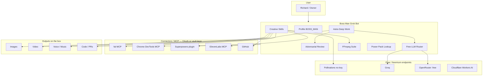

# Boss Man Godmode

**The God of Grok Bots** — one integrated pack for coding *and* creative media.

Boss Man Godmode turns a Cursor / xAI **Grok Bot** into a high-power teammate:
deep planning (Astra mode), adversarial critique, free-tier LLM routing, and a
full creative pipeline (image → video → voice → music → FFmpeg ship).

> **Honesty first:** this repo is glue, skills, profiles, and curated links.
> It does **not** ship real API keys. Secrets stay in your **vault**, plugin
> OAuth, or a local `.env` that is gitignored. Placeholders are marked
> `EXAMPLE_ONLY`. Publishing this pack does **not** auto-install plugins into
> a live bot — you (or your bot) connect them via marketplace / InstallPlugin.

**Target publish:** `warpfusion001/boss-man-godmode`  
**Licence:** MIT (our glue) — see `NOTICE.md` for upstream licences.

---

## What you get

| Layer | What it does |
|-------|----------------|
| **Astra mode** | Claude / GPT-Astra-style loop: plan → research → implement → critique → verify |
| **Creative stack** | Pollinations (no-key images), fal MCP, voice, music beds, FFmpeg suite |
| **Free LLM router** | Groq → OpenRouter `:free` → Gemini → (paid) xAI |
| **Catalog** | Verified Grok Bot repos + creative power pack (stars checked Oct 2026) |
| **Profile** | `profiles/BOSS_MAN.md` — L1 autonomy for coding; ask before public publish/send |

---

## Architecture

---

## Quick start (with a live Grok Bot)

1. **Clone** this repo (or paste skills into your bot’s skill store).
2. **Copy** `.env.example` → `.env` (local only) *or* prefer plugin OAuth + vault.
3. **Connect MCP / plugins** — see [`mcp/README.md`](mcp/README.md):
   - fal: `https://mcp.fal.ai/mcp-relay`
   - Chrome DevTools MCP
   - obra/superpowers (marketplace)
   - Optional: ElevenLabs hosted MCP, Replicate MCP
4. **Install skills** from `skills/*/SKILL.md` into the bot (or point the bot at this repo).
5. **Load profile** [`profiles/BOSS_MAN.md`](profiles/BOSS_MAN.md).
6. **Read** [`docs/ASTRA_MODE.md`](docs/ASTRA_MODE.md) before hard coding / research jobs.
7. **Smoke test (no key):** ask the bot to run `creative-image-pollinations` with a simple prompt.
8. **Never** commit `.env` or paste live keys into a public chat/repo.

---

## Skills included

| Skill | Job |
|-------|-----|
| `creative-image-pollinations` | Zero-key text→image via Pollinations URL |
| `creative-video-pipeline` | Brief → still → video → mux |
| `movie-studio` | Route music-video / explainer / narrative → job card → owner-approved Video Studio handoff |
| `creative-voice` | TTS via ElevenLabs free or local Piper/Chatterbox |
| `creative-music-treblo` | Treblo songs/beds — free web; Melodia API with key (100 credits/v3) |
| `creative-music-bed` | Background beds; flag NC licences |
| `media-ffmpeg-suite` | Concat, 9:16, subtitles, ducking, social presets |
| `free-llm-router` | Route planning prompts across free LLM tiers |
| `astra-deep-work` | High-power plan → research → implement → critique → verify |
| `astra-adversarial-review` | Steelman + red-team the plan/code |
| `prompt-engineering` | Design/eval prompts for research, teaching, agents |
| `systems-reverse-engineering` | Legitimate RE for interoperability & authorized research |
| `defensive-cybersecurity` | Threat models, hardening, vuln triage, responsible disclosure |
| `hailuo-via-fal` | MiniMax Hailuo video through connected fal MCP |
| `git-commit-writer` | Conventional commit message from staged diff |
| `pr-description-writer` | PR body: what / why / how / test plan |
| `readme-generator` | Draft README from repo structure |
| `env-doctor` | Diagnose why a project won't start |
| `truth-first` | Evidence-first verify before changes or “done” |
| `last30days` | Recent multi-source research (Reddit/HN/Polymarket/GitHub/…); MIT vendored |
| `hermes-auto-skills` | Always-on Hermes-style skill create/update + announce (r/GrokBot tip) |
| `email-triage` | Inbox classify + archive plan + draft replies (never auto-send) |
| `meeting-prep` | Pre-meeting brief + post-meeting actions (Calendar via Composio) |
| `engineering-issue-triage` | GitHub/Origin issue summarise / dupes / priority / draft comment |
| `social-content` | LinkedIn/IG/X drafts; never publish; Dave note for IG growth |
| `lead-research` | Company/email → account brief; CRM writes need Composio + approval |
| `power-pack-lookup` | How to use *this* repo as the living bible |

---

## Integrations catalogue

Full curated links (shortlist + creative power pack):  
[`integrations/CATALOG.md`](integrations/CATALOG.md)

Music: [`integrations/TREBLO.md`](integrations/TREBLO.md) — Treblo (free web songs; paid Melodia API).

Felo skills (MIT, need `FELO_API_KEY`): [`integrations/FELO.md`](integrations/FELO.md)

Composio (1000+ apps MCP, plugin `32661537`): [`integrations/COMPOSIO.md`](integrations/COMPOSIO.md)

last30days research (MIT): [`integrations/LAST30DAYS.md`](integrations/LAST30DAYS.md)

| Skill | What it does |
|-------|--------------|
| `felo-search` | Felo web search |
| `felo-x-search` | Felo X/Twitter search |
| `felo-superAgent` | Felo SuperAgent (logo/product images) |
| `felo-slides` | Felo slide decks |
| `felo-youtube-subtitling` | YouTube subtitles |
| `felo-web-fetch` | Fetch pages as clean content |

### Composio workflow skills

See [`integrations/COMPOSIO.md`](integrations/COMPOSIO.md). Pack originals (not article prose):

| Skill | What it does |
|-------|--------------|
| `email-triage` | Classify inbox; draft replies; archive recommendations |
| `meeting-prep` | Pre-brief + post notes/actions |
| `engineering-issue-triage` | Issue summarise, dupes, priority, draft comment |
| `social-content` | LinkedIn/IG/X drafts (Dave for IG growth) |
| `lead-research` | Account brief; CRM via Composio + approval |
| `last30days` | Vendored recent research engine |
| `grok-imagine` | Grok Imagine image/video via RunAPI (Apache-2.0; `RUNAPI_API_KEY`) — [`integrations/GROK_IMAGINE.md`](integrations/GROK_IMAGINE.md) |

Skills marketplace: [`integrations/AGENSI.md`](integrations/AGENSI.md) — Agensi shortlist + MCP (on-demand; never vendor their skill files).

Preserved core shortlist:

- [awesome-grok-bot](https://github.com/ZeroPointRepo/awesome-grok-bot)
- [xai-org/plugin-marketplace](https://github.com/xai-org/plugin-marketplace)
- [cursor/plugins](https://github.com/cursor/plugins)
- [grok-bot-templates](https://github.com/cobusgreyling/grok-bot-templates)
- [obra/superpowers](https://github.com/obra/superpowers)
- [grok-bot-profiles](https://github.com/HAEGONG/grok-bot-profiles)
- [awesome-grokbot-playbooks](https://github.com/sit-in/awesome-grokbot-playbooks)
- [chrome-devtools-mcp](https://github.com/ChromeDevTools/chrome-devtools-mcp)
- [grok-bot-cli](https://github.com/ScriptedAlchemy/grok-bot-cli)
- [templatesgrokbot.com](https://github.com/templatesgrokbot/templatesgrokbot.com)

---

## Safety / never-list (summary)

- No fabricated or scraped API keys.
- No voice cloning without explicit consent of the voice owner.
- No public publish, email/Slack send, purchase, or ticket create without owner approval.
- Respect non-commercial model weights (e.g. MusicGen).
- Default **L1**: draft and show; escalate irreversible actions.

Full contract: [`profiles/BOSS_MAN.md`](profiles/BOSS_MAN.md).

---

## Docs

- [`docs/ASTRA_MODE.md`](docs/ASTRA_MODE.md) — high-power reasoning operating contract
- [`mcp/README.md`](mcp/README.md) — connect fal, DevTools, Superpowers, etc.
- [`NOTICE.md`](NOTICE.md) — third-party licences

---

*Built for Richard Drinkwater / Boss Man · UK English · Oct 2026*
